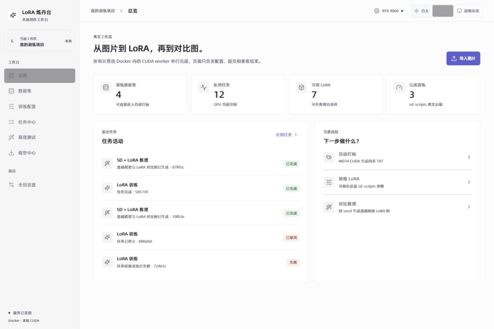
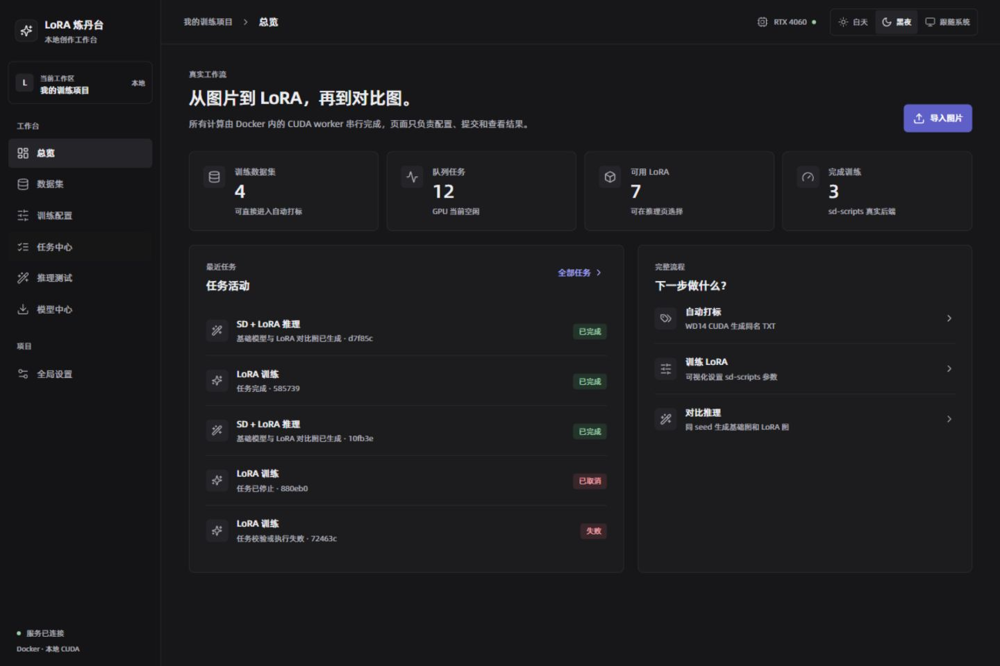
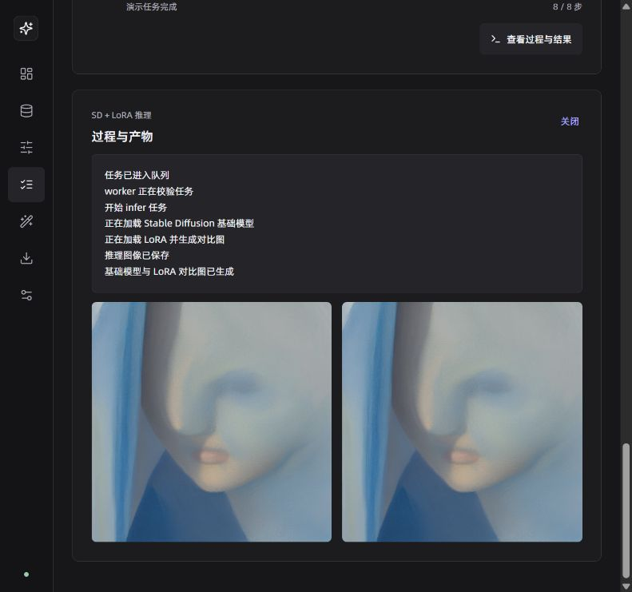

# Docker、项目架构与 UI 整理报告

更新：2026-10-08。所有构建、SSH 集成测试、训练和推理均在 Docker 中完成。

## 1. 为什么这样整理

平台保留四个职责明确的服务：前端显示界面，API 管理数据与配置，worker 串行执行 GPU 任务，独立 ComfyUI 执行推理。日常运行无需让前端开发服务器常驻。训练与推理镜像共享 CUDA/训练基础层，显示的 14 GB 与 16 GB 镜像尺寸不能直接相加当作实际独占磁盘占用。

| 项目 | 整理前 | 整理后 |
| --- | --- | --- |
| 日常前端 | Node + Vite 开发服务器 | Nginx 静态网页 |
| 前端运行镜像 | 约 880 MB | 约 136 MB，显示尺寸减少约 85% |
| 前端运行依赖 | 源码挂载、node_modules 卷 | 编译产物和嵌入字体，无 Node 运行依赖 |
| API | reload 模式 | 正常运行模式，源码复制进镜像 |
| 状态与下载缓存 | 三个项目命名卷，查找分散 | data/state、data/cache；开发依赖在 data/dev |
| 服务启动 | 无健康就绪条件 | API 健康后启动前端与 worker |
| 容器日志 | 无明确上限 | 每服务 10 MB × 3 轮转 |
| 项目构建上下文 | 分别排除部分数据子目录 | 整个 data、SD 用户数据、备份、文档和日志排除 |
| 日常启动 | 控制台等待，无限重试 | 后台启动、有限超时、日志和失败提示 |

CUDA 与 sd-scripts 已验证的依赖保留。构建缓存仍由 Docker 管理，本次未全局清空；跨项目共享缓存不能作为 LoRA 专属数据处理。

## 2. 存储与恢复

| 主机路径 | 容器路径 | 内容 |
| --- | --- | --- |
| D:\LoRA\data | /data | 模型、数据集、训练及推理输出 |
| D:\LoRA\data\state | /state | SQLite、WAL、SHM，SSH 配置 |
| D:\LoRA\data\cache | /cache | Hugging Face 与 Torch 缓存 |
| D:\LoRA\data\dev\node_modules | /app/frontend/node_modules | 仅开发模式使用 |
| D:\LoRA\stable-diffusion\user | /opt/ComfyUI/user | 独立 SD 用户配置 |

迁移顺序：停止 API 与 worker → 使用 SQLite backup 迁出数据库 → 完整性检查 → 迁出缓存 → 新配置启动 → 从前端真实短训与推理 → 导出原始恢复备份并比较 28 个缓存文件 SHA256 → 删除确认已停用的三个项目卷。

原有 10 条任务记录保留，新验证增加两条真实任务。原始恢复备份为 `data/backups/state-before-20261008.db`。恢复需停止 API/worker 后，将备份通过 SQLite backup 写入目标数据库；不要在运行时直接覆盖数据库或 WAL 文件。

Docker Desktop 的全局磁盘仍位于 D:\docker。镜像层由引擎统一管理；LoRA 的可持久文件均放在 D:\LoRA。

## 3. Linear 风格和字体

原有七个页面及功能位置保留。改为安静的灰阶侧栏、细边框、统一圆角、紧凑标题栏和少量紫色主要操作。设置右上角提供白天、黑夜、跟随系统，选择保存到浏览器；刷新不会丢失主题。

中英文使用本地阿里巴巴普惠体 2.0，400、500、600、700 四个字重。原始 WOFF2、官方来源、哈希清单位于 `frontend/public/fonts`；移除了 Google Fonts 外链。目录弹窗单独封装，支持 Esc、Tab 焦点限制、关闭后恢复焦点以及读取错误提示。

## 4. SSH 扩展

全局设置新增 SSH 卡片。输入 AutoDL 或其他服务器地址、端口、用户名及远程目录，获取服务器指纹，核对后确认，再使用密码或本地文件选择器上传私钥进行登录测试。凭据仅用于本次验证，不写入数据库、配置文件或任务日志。

| 接口 | 用途 |
| --- | --- |
| GET /api/remote/ssh/config | 读取非敏感连接配置 |
| PUT /api/remote/ssh/config | 保存非敏感配置与确认的指纹 |
| POST /api/remote/ssh/probe | 完成真实 SSH 握手并返回 SHA256 指纹 |
| POST /api/remote/ssh/test | 核对指纹、密码/私钥登录、尝试通过 SFTP 查询目录 |

本次实现的是可连接和验证的扩展边界。远程训练任务调度、数据同步、远程 GPU 选择尚未启用；现有 GPU 作业继续在本机运行。用户未提供外部服务器，因此未宣称已连接实际 AutoDL 账号。

## 5. 实际回归验证

| 验证项 | 结果及证据 |
| --- | --- |
| 前端构建 | Docker 内 TypeScript 与 Vite 构建通过，logs/ui-final-build-20261008.log |
| 运行服务 | API 与 web 健康，GPU worker 和独立 ComfyUI 运行 |
| 数据库 | PRAGMA integrity_check=ok，原有 10 条任务记录保留 |
| CUDA | torch.cuda.is_available=True，RTX 4060 Laptop GPU 上张量计算结果 32 |
| 真实训练 | job_478579585739，从前端提交，1/1 步，Rank 4，loss 0.00949，成功输出 safetensors |
| 真实推理 | job_f93a7cd7f85c，从前端提交，固定 seed 42、20 步，基础图与新 LoRA 图均生成 |
| SSH 协议测试 | 容器内临时 SSH 服务器，握手、密码、私钥、错误密码、错误指纹共 5 项通过 |
| 字体 | 浏览器确认 PuHuiTi 加载完成；资源来自 localhost |
| 主题 | 白天、黑夜切换与刷新保持验证通过 |
| 设置编辑 | 持续轮询后未保存输入保持，修复轮询重置表单 |
| 启动器 | Windows PowerShell 5.1 后台脚本验证通过，API 就绪日志保存 |

短训仅证明训练与产物链路可运行，1 步不足以评价 LoRA 学习质量。完整输出与图片可在任务中心查看。

真实训练输出：`data/runs/architecture_check_20261008/architecture_check_20261008.safetensors`。训练过程：`data/runs/job_478579585739/logs.txt`。逐步变更记录：`logs/changes.log`。

响应式验证记录见 `logs/ui-responsive-20261008.json`；检查覆盖 375px 窄屏和桌面布局。首轮发现模型长名称溢出，已修复并复查无溢出；同一套布局变量支持双主题。
