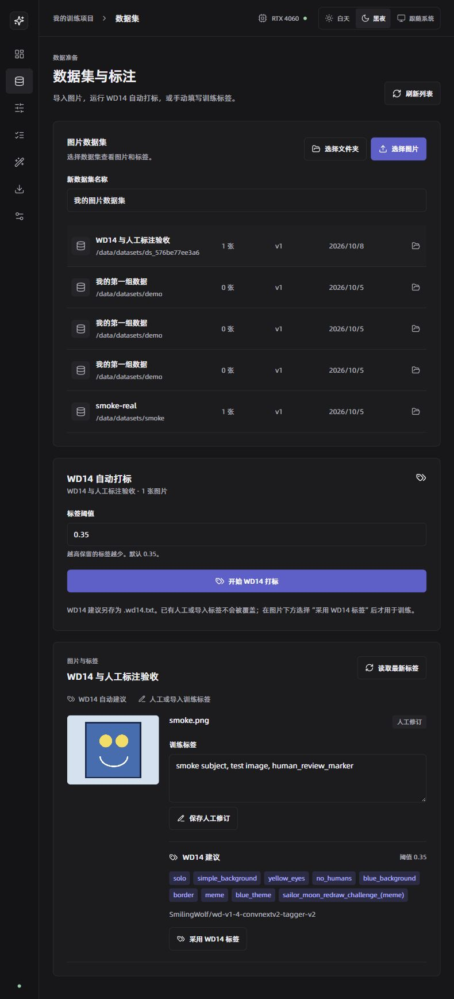
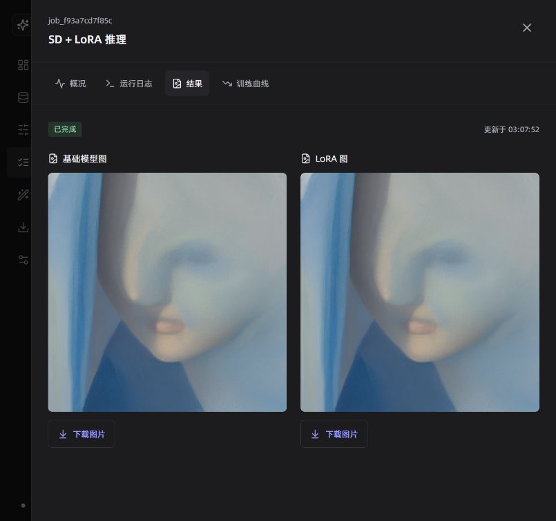
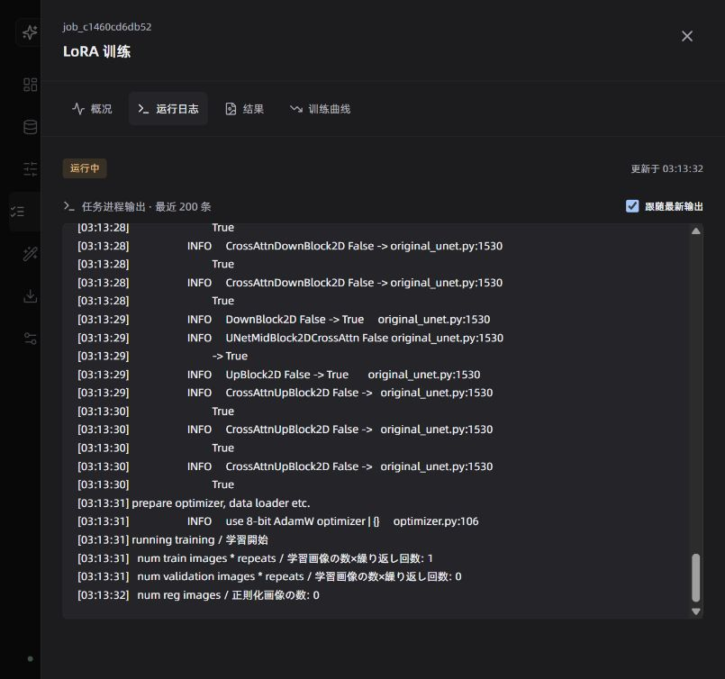
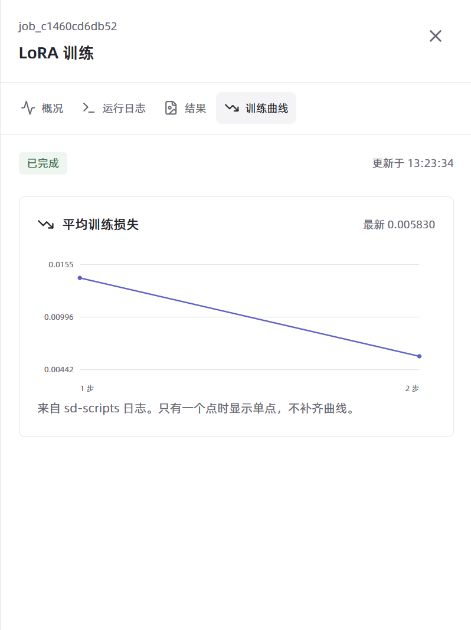
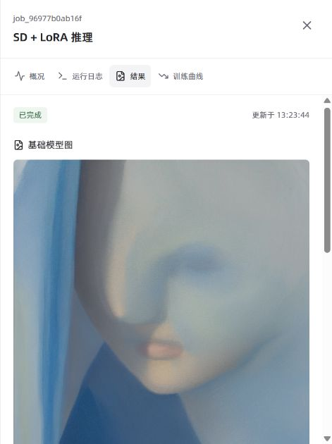

# 功能更新与验收记录

日期：2026-10-08。项目：D:\LoRA。所有程序执行、构建、打标和训练均在 Docker 内完成。

## 改动

1. 任务详情从页面底部改为右侧抽屉，点击后立即显示加载状态，包含概况、日志、结果和曲线；失败显示原因并重试。
2. 新增容器 PowerShell 7.6.6、Bash、Python 命令控制。输出合并 stdout/stderr，可查看退出码、停止和超时；这是非交互命令模式。
3. SSH 支持连接执行命令和服务器输出；指纹校验后才认证，凭据不落盘。远程 GPU 自动训练调度尚未启用。
4. 新增实际损失采样、状态分布和完成任务耗时图。修复 worker 没有写结束时间的问题；历史耗时不推算。
5. WD14 建议使用 .wd14.txt，训练标签使用 .txt；保留来源、模型、阈值与关联任务，保护人工和导入标签。
6. 使用项目 product-language skill 修订文案。PRD 覆盖禁止项、约束项、常项与验收标准。

## 验收结果

| 检查 | 结果 | 证据 |
| --- | --- | --- |
| web / API 镜像构建 | 通过 | logs/features-web-final-build-20261008.log、console-api-build-final-20261008.log |
| 三种容器环境、stderr、非零退出码、流式输出、停止、超时、拒绝越界工作目录 | 5 个测试通过，包含三种环境子用例 | logs/console-http-tests-20261008.log |
| SSH 密码／私钥登录、探测指纹、错误凭据／指纹、远端 stdout/stderr 与退出码 | 6 个测试通过 | logs/ssh-command-tests-20261008.log |
| AutoDL 实机连接 | 未执行 | 缺少用户服务器连接信息；没有声称外部服务器已通过 |
| 前端 PowerShell | 通过，版本 7.6.6、目录 /data、退出码 0 | screenshots/container-powershell-20261008.jpg |
| 结果按钮 | 通过，抽屉立即打开，基础图和 LoRA 图可见 | screenshots/task-results-drawer-20261008.jpg |
| WD14 CUDA | 通过，job_05c51634df9e，CUDAExecutionProvider，23 秒 | data/runs/job_05c51634df9e/logs.txt |
| 人工标签保护和来源切换 | 通过，人工标记保留；采用 WD14 后 TXT 更新；再人工保存恢复人工来源 | 数据集 ds_576be77ee3a6、caption_records 与 TXT |
| 白天主题与窄屏抽屉 | 375px 视口，页面 scrollWidth 375，抽屉宽度约 375；字体 PuHuiTi | screenshots/task-drawer-mobile-light-20261008.jpg |
| 新增 CUDA 短训练 | 通过，job_c1460cd6db52，2 步 Rank 4；loss 0.0141 → 0.00583；产物 4832184 字节 | data/runs/job_c1460cd6db52/logs.txt |
| 新 LoRA 对比推理 | 通过，job_96977b0ab16f，实际生成基础图与新 LoRA 图 | data/outputs/lora-platform/job_96977b0ab16f/ |
| SSH 多段表单与会话轮询 | 通过，实际 stdout/stderr、目录 /tmp、退出码 0 | logs/ssh-http-tests-20261008.log |
| API 重建后代理连接 | 通过；Nginx 改用 Docker DNS 动态解析 | logs/final-web-proxy-build-20261008.log |
| 损失图最终视觉复核 | 通过，标题图标与两点曲线显示正常 | screenshots/training-loss-verified-20261008.jpg |
| SSH 输出最终前端复核 | 通过，显示 /tmp、stdout、stderr，正常结束且凭据清空 | screenshots/ssh-browser-output-verified-20261008.jpg |
| 新 LoRA 图片前端复核 | 通过，两张图片 complete 为 true 且 naturalWidth 大于 0 | screenshots/new-lora-results-verified-20261008.jpg |

## 前端操作流程

从浏览器选择 smoke.png 导入新验收数据集 → 保存人工标记 → 提交 WD14 → 打开任务中心 → 回到数据集查看 WD14 建议 → 采用建议 → 再保存人工训练标签 → 配置两步 Rank 4 训练 → 打开任务抽屉查看日志和曲线。

## 文档与范围

[Google Docs PRD](https://docs.google.com/document/d/1GNCXej-7wwAiraqPzF8uq0LChetQss-ZgxEREL_7LVE/edit)

本地 PRD：docs/product-requirements.md。文档回读已确认十个主章节、八个功能小节、日期芯片与验收截图。全局目录动态联动、任意模型平台下载、完整 TTY、远程训练队列分别列为后续事项，未标为已完成。

内置浏览器曾出现“页面崩溃”；其 data 协议错误页被浏览器安全策略拒绝控制，未绕过策略。用户恢复并要求继续后，完成损失图、SSH 输出和新模型推理图片的前端复核；本轮待验收项已完成。AutoDL 实机与远程训练调度仍未接入。

控制台命令在 API 容器运行；该容器没有 worker 的 CUDA Python 环境。终端会话暂存在内存；正式任务 stdout 与产物保存在 data/runs。停止 SSH 只关闭通道，远端后台进程需另行确认。
